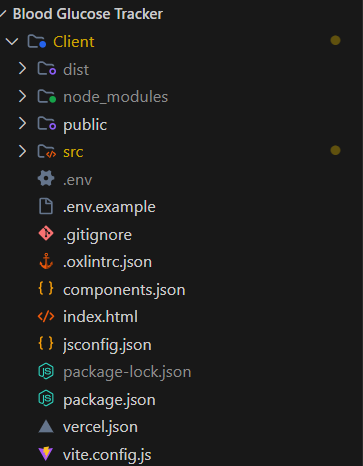
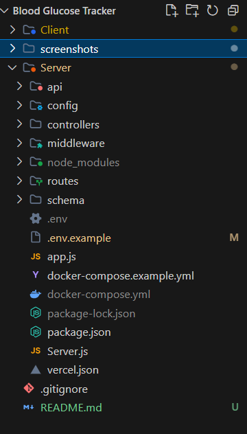
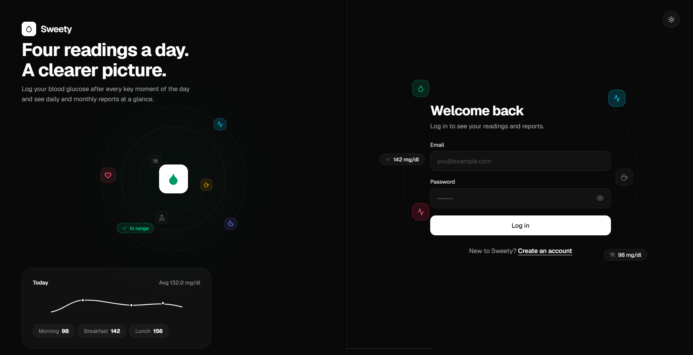
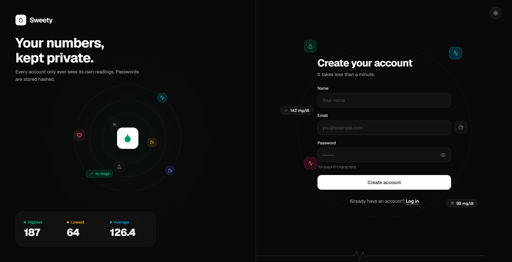
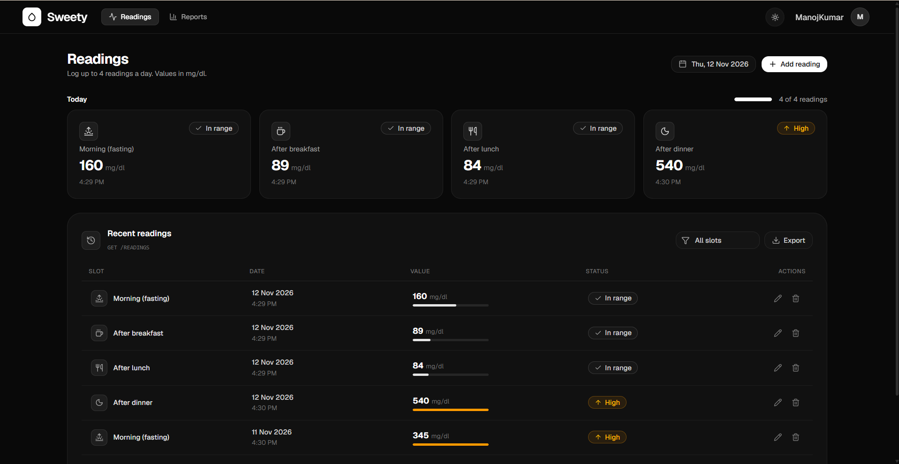
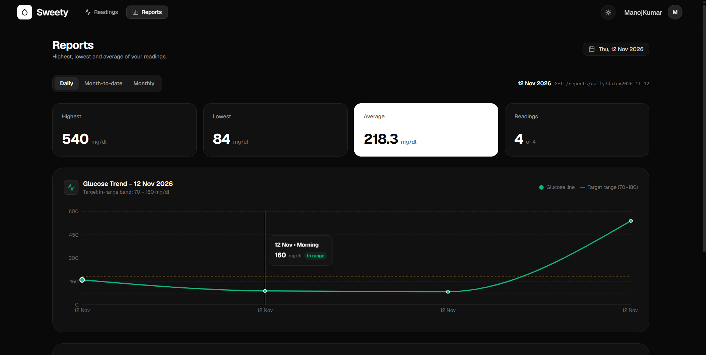

# Sweety – Blood Glucose Tracker

A full-stack blood glucose tracking application built using
React, Node.js, Express.js and PostgreSQL.

## 1. Features

- User registration and login
- Secure password hashing using bcrypt
- Add, view, edit and delete glucose readings
- Maximum four readings per day
- Input validation
- Daily reports
- Month-to-date reports
- Previous monthly reports
- User-specific reading management

## 2. Tech Stack

### Frontend
- React
- Vite
- JavaScript
- Tailwind CSS
- shadcn

### Backend
- Node.js
- Express.js
- PostgreSQL
- bcrypt
- JWT 

### Database
- PostgreSQL
- Docker 

## 3. Project Structure

Show your actual client and server folder structure.





## 4. Prerequisites

- Node.js
- npm
- Docker Desktop 
- PostgreSQL 

## 5. Installation

### Clone Repository

git clone YOUR_GITHUB_REPOSITORY_URL

cd sweety-blood-glucose-tracker

### Install Backend Dependencies

cd ../server
npm install

### Install Frontend Dependencies

cd ../client
npm install

## 6. Environment Variables

Explain how to configure .env files.

cp .env.example .env

List the required variables and their purpose.
Never include actual secrets.


## 7. Database Setup (Docker)

This project uses PostgreSQL 17 running inside Docker.

### Prerequisites

- Docker Desktop installed and running.

### Step 1: Configure Docker Compose

The project includes a `docker-compose.yml` file with the following configuration:

```yaml
services:
  postgres:
    image: postgres:17-alpine
    container_name: your-app-postgres
    restart: unless-stopped
    environment:
      POSTGRES_USER: your_db_user
      POSTGRES_PASSWORD: your_db_password
      POSTGRES_DB: your_db_name
    ports:
      - "5432:5432"
    volumes:
      - postgres_data:/var/lib/postgresql/data

volumes:
  postgres_data:
```

Replace the placeholder database credentials with the values used in your project.

### Step 2: Start PostgreSQL

Pull the PostgreSQL image and start the database container:

```bash
docker compose up -d
```

Docker automatically downloads the required PostgreSQL image if it is not available locally and starts the container in the background.

### Step 3: Initialize Database

The application database schema and initial demo data are initialized using the project's database initialization and seed scripts.

The seed script creates a demo user with sample blood glucose readings.

Run the seed command:

```bash
npm run seed
```

Use the actual seed command configured in your server's `package.json`.

**Note:** Database initialization and seeding are required only when setting up the database for the first time, unless you intentionally reset the database.

### Step 4: Verify Database Container

docker compose ps


### Step 5: Stop PostgreSQL

To stop the running containers:

```bash
docker compose down
```

**Important:** Stopping containers does not delete database data. PostgreSQL data is persisted using the Docker named volume `postgres_data`.

To completely remove the database and its stored data:

```bash
docker compose down -v
```

**Warning:** This permanently deletes the PostgreSQL data stored in the Docker volume.


## 8. Running the Application

### Start Backend

cd server
npm run dev

### Start Frontend

cd client
npm run dev

Mention the actual backend and frontend URLs.

## 9. API Documentation

List your implemented API endpoints.

### Authentication
- POST /api/auth/register
- POST /api/auth/login

### Readings
- GET /api/readings
- POST /api/readings
- PUT /api/readings/:id
- DELETE /api/readings/:id

### Reports
- GET /api/reports/daily
- GET /api/reports/month-to-date
- GET /api/reports/monthly

Use your actual endpoint names and query parameters.


## 11 Application Screenshots

### Login Page


### Register Page


### Reading Management



### Reports



## Notes

### Assumptions

- Each user can manage only their own blood glucose readings.
- A user can record a maximum of four readings per day, one for each time slot.
- All glucose values are stored in mg/dL as whole numbers between 40 and 600.
- Future dates are not allowed, but previous dates can be selected.
- The application uses the following fixed reading slots:
  - Morning (Fasting)
  - After Breakfast
  - After Lunch
  - After Dinner
- The monthly report displays the entire previous calendar month, while the month-to-date report displays readings from the first day of the selected month up to the selected date.
- All report calculations are based on the authenticated user's readings.
- Passwords are securely hashed using bcrypt before storing them in the database.
- PostgreSQL is used as the primary database.

### What I'd Improve With More Time

- Add interactive glucose trend charts using Recharts.
- Implement pagination and filtering for reading history.
- Improve accessibility and responsiveness across different devices
  expect mobile 
- Implement CI/CD automation for streamlined testing and deployment.
